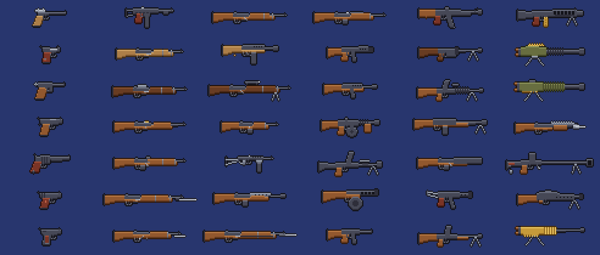

# WW2 Guns (Terraria / tModLoader)

Mod de **tModLoader 1.4.4** que agrega **42 armas de fuego de la Segunda Guerra Mundial**: 6 por cada país principal del Eje (Alemania, Italia, Japón) y de los Aliados (Estados Unidos, Reino Unido, Unión Soviética, Francia).

*A tModLoader mod that adds 42 WWII firearms (6 per nation). English and Spanish translations included.*



## Cómo se consiguen

Igual que en el juego base, las armas se consiguen de tres formas:

1. **Crafteo** (todas): en Yunque o Yunque de mithril, con lingotes del nivel correspondiente.
2. **Tienda del Traficante de armas (Arms Dealer)**: las pistolas, y la Thompson y la Trench Gun en Hardmode.
3. **Drops raros** de enemigos de la mazmorra en Hardmode y de piratas.

Todas usan **balas** como munición (bala de mosquete, bala de plata, bala de meteorito, etc.), igual que el Minishark o el Rifle de francotirador.

### Niveles de crafteo

| Nivel | Momento de la partida | Materiales | Estación |
|---|---|---|---|
| 1 | Pre-jefes (hierro/plomo) | 10 Lingote de hierro/plomo, 5 Madera | Yunque |
| 2 | Pre-jefes (plata/tungsteno) | 12 Lingote de plata/tungsteno, 8 Madera | Yunque |
| 3 | Post Eater of Worlds / Brain of Cthulhu | 12 Lingote de demonita/carmesí, 6 Lingote de hierro/plomo | Yunque |
| 4 | Meteorito + piedra infernal | 12 Lingote de meteorito, 6 Lingote de piedra infernal | Yunque |
| 5 | Hardmode temprano (cobalto/paladio) | 12 Lingote de cobalto/paladio, 1 Piezas de arma ilegales | Yunque |
| 6 | Hardmode (mithril/oricalco) | 12 Lingote de mithril/oricalco, 6 Alma de la noche | Yunque de mithril/oricalco |
| 7 | Hardmode (adamantita/titanio) | 14 Lingote de adamantita/titanio, 8 Alma de la noche, 1 Piezas de arma ilegales | Yunque de mithril/oricalco |
| 8 | Post mecánicos (lingotes sagrados) | 15 Lingote sagrado, 10 Alma de poder | Yunque de mithril/oricalco |

## Armas

| País | Arma | Tipo | Daño | Tiempo de uso | Nivel | Otras formas de obtenerla |
|---|---|---|---|---|---|---|
| Alemania | Luger P08 | Pistola | 12 | 16 | 1 | Tienda del Traficante de armas |
| Alemania | MP 40 | Subfusil | 11 | 7 | 4 | - |
| Alemania | Karabiner 98k | Rifle de cerrojo | 38 | 40 | 3 | - |
| Alemania | Gewehr 43 | Rifle semiautomático | 34 | 18 | 5 | - |
| Alemania | StG 44 | Fusil de asalto | 28 | 8 | 7 | - |
| Alemania | MG 42 | Ametralladora | 30 | 4 | 8 | Drop 1/12 de TacticalSkeleton |
| Italia | Beretta M1934 | Pistola | 10 | 14 | 1 | Tienda del Traficante de armas |
| Italia | Carcano M91/38 | Rifle de cerrojo | 30 | 38 | 2 | - |
| Italia | Beretta MAB 38 | Subfusil | 12 | 8 | 4 | - |
| Italia | FNAB-43 | Subfusil | 18 | 7 | 5 | - |
| Italia | Breda 30 | Ametralladora ligera | 22 | 10 | 5 | - |
| Italia | Breda M37 | Ametralladora | 34 | 9 | 7 | - |
| Japón | Nambu Type 14 | Pistola | 11 | 17 | 1 | Tienda del Traficante de armas |
| Japón | Arisaka Type 99 | Rifle de cerrojo | 36 | 40 | 3 | - |
| Japón | Type 97 Sniper Rifle | Rifle de cerrojo | 95 | 45 | 6 | Drop 1/8 de SkeletonSniper |
| Japón | Type 100 SMG | Subfusil | 11 | 7 | 4 | - |
| Japón | Type 96 LMG | Ametralladora ligera | 26 | 8 | 6 | - |
| Japón | Type 92 HMG | Ametralladora | 40 | 9 | 8 | - |
| Estados Unidos | Colt M1911 | Pistola | 17 | 16 | 2 | Tienda del Traficante de armas |
| Estados Unidos | M1 Garand | Rifle semiautomático | 28 | 14 | 4 | - |
| Estados Unidos | M1 Carbine | Rifle semiautomático | 18 | 12 | 3 | - |
| Estados Unidos | Thompson M1928 | Subfusil | 20 | 6 | 5 | Tienda del Traficante de armas, Drop 1/20 de PirateDeadeye |
| Estados Unidos | Browning BAR | Ametralladora ligera | 34 | 10 | 6 | - |
| Estados Unidos | M1897 Trench Gun | Escopeta de corredera | 20 x5 | 40 | 5 | Tienda del Traficante de armas |
| Reino Unido | Webley Mk VI | Pistola | 22 | 22 | 2 | Tienda del Traficante de armas |
| Reino Unido | Lee-Enfield No. 4 | Rifle de cerrojo | 34 | 30 | 3 | - |
| Reino Unido | Sten Mk II | Subfusil | 9 | 7 | 3 | - |
| Reino Unido | Bren Gun | Ametralladora ligera | 30 | 9 | 6 | - |
| Reino Unido | De Lisle Carbine | Rifle de cerrojo | 40 | 30 | 5 | - |
| Reino Unido | Boys Anti-Tank Rifle | Fusil antitanque | 160 | 50 | 8 | Drop 1/10 de SkeletonCommando |
| Unión Soviética | Tokarev TT-33 | Pistola | 13 | 15 | 1 | Tienda del Traficante de armas |
| Unión Soviética | Mosin-Nagant M91/30 | Rifle de cerrojo | 32 | 42 | 2 | - |
| Unión Soviética | SVT-40 | Rifle semiautomático | 32 | 16 | 5 | - |
| Unión Soviética | PPSh-41 | Subfusil | 18 | 4 | 6 | - |
| Unión Soviética | PPS-43 | Subfusil | 12 | 7 | 4 | - |
| Unión Soviética | DP-27 | Ametralladora ligera | 32 | 9 | 7 | - |
| Francia | MAS 1935 | Pistola | 11 | 15 | 1 | Tienda del Traficante de armas |
| Francia | MAS-36 | Rifle de cerrojo | 35 | 36 | 3 | - |
| Francia | Lebel M1886 | Rifle de cerrojo | 30 | 40 | 2 | - |
| Francia | MAS-38 | Subfusil | 9 | 7 | 3 | - |
| Francia | FM 24/29 | Ametralladora ligera | 24 | 10 | 5 | - |
| Francia | Hotchkiss M1914 | Ametralladora | 36 | 10 | 7 | - |

Menor "tiempo de uso" = dispara más rápido. Las ametralladoras tienen probabilidad de no gastar munición, la escopeta dispara 5 perdigones, el Type 97 tiene mira telescópica y el Boys atraviesa enemigos.

## Instalar para probar

1. Cloná este repo dentro de `Documentos/My Games/Terraria/tModLoader/ModSources/` **con el nombre de carpeta `WW2Guns`** (tiene que coincidir con el nombre interno del mod):
   ```
   git clone https://github.com/jonatanmonti/Terraria-Mod-WW2-Guns.git WW2Guns
   ```
2. Abrí tModLoader → **Workshop → Develop Mods** → **Build + Reload** en WW2 Guns.

## Editar los sprites

Los sprites se generan con Python (`pip install pillow`):

```
python tools/gen_mod.py   # sprites .png + código .cs + traducciones
python tools/art.py       # icon.png, icon_workshop.png e imágenes de workshop/
```

Los dibujos de cada arma están en `tools/guns.py` y las estadísticas en `tools/stats.py`. También podés editar los `.png` a mano (Aseprite, Piskel, etc.), pero si volvés a correr `gen_mod.py` se sobrescriben.

## Licencia

Todos los derechos reservados. Ver [LICENSE](LICENSE).
